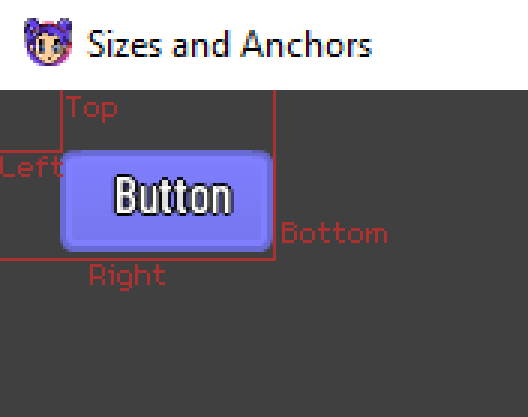
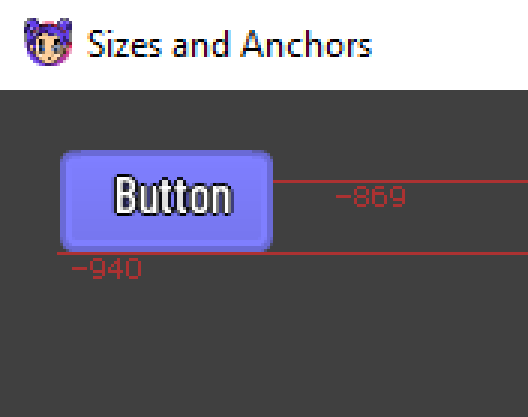

As we all know when creating a game we are most likely going to need to support devices using a different resolution and aspect ratio. We can handle this in several ways but for this instance we are going to imagine that the resolution is static and we are going to move each control into position.

## Margins

We can do that by either editing the margin properties of the control _(left, top, right, bottom)_ or the position and width/height properties of the control _(x, y, width, height)_.
By default, the margin properties represent a distance in pixels relative to the top-left corner of the parent control or the viewport.



### Adjust Margins by position

An example of setting a controls `x` and `y` properties and the margin calculation results:

```kotlin
val scene = sceneGraph(context, batch = batch) {
    control {
        fillParent()

        button {
            text = "Button"

            x = 20f
            y = 20f
        }
    }
}
```

Outputs the calculated margins as so:

```kotlin
marginLeft: 20.0
marginTop: 20.0
marginRight: 91.0
marginBottom: 54.0
```


### Adjust Anchor Point

If we change the button controls right and left anchors to `1f` we will see the will see the margin values become relative to the top right corner of the parent control or viewport.

```kotlin
val scene = sceneGraph(context, batch = batch) {
    control {
        fillParent()

        button {
            anchorRight = 1f
            anchorLeft = 1f

            text = "Button"

            x = 20f
            y = 20f
        }
    }
}
```

```kotlin
marginLeft: -940.0
marginTop: 20.0
marginRight: -869.0
marginBottom: 54.0
```



## Anchor Presets

Instead of manually adjusting margin and anchor values, we can use the `anchor()` method of a control node to automatically align and resize the node to the specified layout.

Do note that if end up adjusting the position or sizes of the control manually, after settings the anchor preset, it will no longer automatically update to that preset. We would have to set the preset again in order for it to calculate it automatically.

### Centering a Node

Example of aligning a button to the center of its parent:

```kotlin
val scene = sceneGraph(context, batch = batch) {
    control {
        fillParent()

        button("Button") {
            centerInParent()
        }
    }
}
```

`centerInParent()` is the same as `anchor(AnchorLayout.CENTER)`.

### Filling the Parent

Stretch a control over its whole parent, optionally keeping a margin from each edge:

```kotlin
control {
    fillParent(margin = 10f)
}
```

Any preset can take a margin as well:

```kotlin
button("Button") {
    anchor(AnchorLayout.TOP_WIDE, margin = 10f)
}
```

### Setting All Anchors

Set all four anchors at once with `anchors()`:

```kotlin
button("Button") {
    anchors(left = 1f, top = 0f, right = 1f, bottom = 0f)
}
```

## Sizing in Containers

When a control is inside a [container](/docs/0.12.0/ui/containers), its [size flags](/docs/0.12.0/ui/containers#size-flags) decide how much space it takes.

### Expand

Take up the free space of the parent container. The ratio sets the share between expanding siblings:

```kotlin
row {
    button("Small") { expandWidth() }
    button("Big") { expandWidth(ratio = 2f) }
}
```

Use `expand()` for both axes or `expandHeight()` for only the vertical axis.

### Shrink

Keep the control at its minimum size and place it at the start, center, or end of its space:

```kotlin
column {
    button("Begin") { shrinkBegin(vertical = false) }
    button("Center") { shrinkCenter(vertical = false) }
    button("End") { shrinkEnd(vertical = false) }
}
```

## Minimum Size

Set the minimum width and height of a control with `minSize()`:

```kotlin
button("Button") {
    minSize(120f, 40f)
}
```
